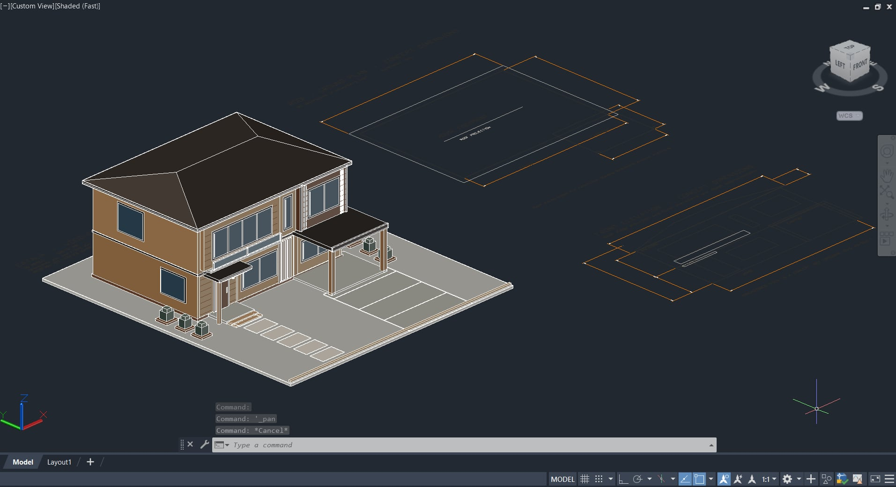

# 3D-Floor-Plan

3D house models and floor plans drafted in AutoCAD.

## Contents

| Folder | Description | Model | Preview |
| --- | --- | --- | --- |
| `2 story` | Two-story house with wood-textured walls, a dark hip roof, stone-textured columns, and an upper-floor balcony on a concrete slab | `activity-8-catala-louise.dwg` | `Screenshot 2026-10-31 185807.png` |
| `wooden` | Two-story house with a hip roof, covered entry, carport, driveway, walkway, and planters, shown with its roof and floor outlines | `Wooden Floor plan.dwg` | `eac7b477-06c0-4835-b86c-1364bfcb0826.jpg` |

## Previews

### 2 Story (Realistic)


### Wooden (Shaded)



## Project Details

| Detail | Value |
| --- | --- |
| Software | Autodesk AutoCAD 2023 |
| File format | DWG |
| Model type | 3D |
| Units | Millimeters (mm) |
| Number of models | 2 |

## Units

All drawings use millimeters (mm).

## Repository Structure

```
3D-Floor-Plan/
├── 2 story/
│   ├── activity-8-catala-louise.dwg
│   ├── activity-8-catala-louise.bak
│   └── Screenshot 2026-10-31 185807.png
├── wooden/
│   ├── Wooden Floor plan.dwg
│   ├── Wooden Floor plan.dwl
│   ├── Wooden Floor plan.dwl2
│   └── eac7b477-06c0-4835-b86c-1364bfcb0826.jpg
└── README.md
```

## Requirements

- AutoCAD 2023 or later, or DWG TrueView (free from Autodesk)

## Author

Orland Louise Catala
GitHub: [@LouiseCatala](https://github.com/LouiseCatala)
